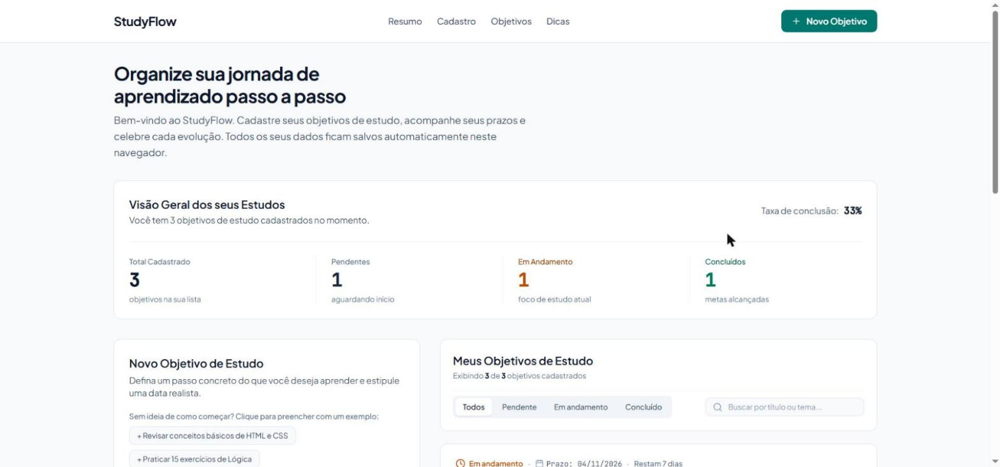
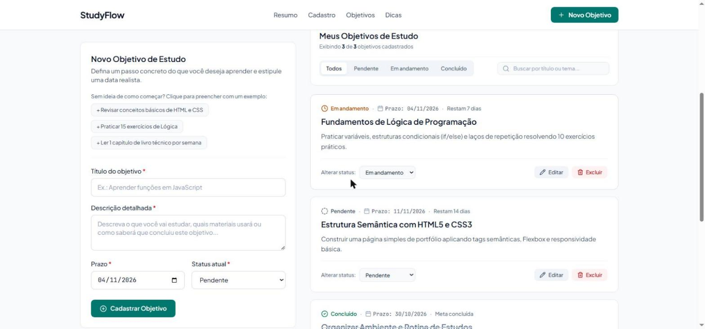

<h1 align="center">StudyFlow</h1>

<p align="center">
  Um painel para estudantes organizarem a rotina acadêmica: objetivos de estudo com prazos, status e acompanhamento do progresso.
</p>

<p align="center">
  <a href="https://bpontesleal-coder.github.io/Study-Flow/"><strong>Acessar o StudyFlow</strong></a>
</p>

<p align="center">
  
  
  
  
  
</p>



## Sobre o projeto

Quem está começando a estudar programação costuma anotar metas soltas e perder o controle do que já fez. O StudyFlow reúne os objetivos de estudo em um só lugar, com prazo e situação de cada um, e mostra de forma visual quanto do planejamento já foi concluído.

Os dados ficam salvos no próprio navegador, então não é preciso criar conta nem instalar nada.

## Funcionalidades

- **Cadastro de objetivos** com título, descrição, prazo e status (pendente, em andamento ou concluído)
- **Sugestões prontas** para quem não sabe por onde começar, com um clique para preencher o formulário
- **Edição e exclusão**, com janela de confirmação antes de apagar
- **Mudança rápida de status** direto no cartão do objetivo
- **Contagem de prazo**: mostra quantos dias faltam ou há quantos dias o objetivo está atrasado
- **Filtro por status e busca** por título ou descrição
- **Resumo do progresso**: totais por status e taxa de conclusão
- **Dados salvos no navegador** (`localStorage`), sincronizados entre abas abertas
- **Dicas de estudo** para definir metas pequenas e prazos realistas



## Tecnologias

| Tecnologia | Uso |
|---|---|
| React 19 | Interface em componentes e controle de estado |
| TypeScript | Tipagem dos objetivos, status e propriedades dos componentes |
| Vite | Ambiente de desenvolvimento e geração da versão de produção |
| Tailwind CSS 4 | Estilização e layout responsivo |
| Lucide | Ícones |
| GitHub Actions | Publicação automática no GitHub Pages a cada atualização |

## Como executar

Requisito: [Node.js](https://nodejs.org/) 20 ou superior.

```bash
git clone https://github.com/bpontesleal-coder/Study-Flow.git
cd Study-Flow
npm install
npm run dev
```

Depois, abra o endereço exibido no terminal (por padrão, `http://localhost:5173/Study-Flow/`).

| Comando | O que faz |
|---|---|
| `npm run dev` | Inicia o ambiente de desenvolvimento |
| `npm run lint` | Verifica os tipos do TypeScript |
| `npm run build` | Gera a versão de produção na pasta `dist` |
| `npm run preview` | Abre localmente a versão de produção |

## Estrutura

```
src/
├── App.tsx                     estado principal e ações (criar, editar, excluir)
├── components/
│   ├── Header.tsx              cabeçalho e navegação
│   ├── GoalStats.tsx           resumo e taxa de conclusão
│   ├── GoalForm.tsx            formulário de cadastro e edição
│   ├── GoalList.tsx            lista, filtro por status e busca
│   ├── GoalCard.tsx            cartão do objetivo e contagem do prazo
│   ├── DeleteConfirmModal.tsx  confirmação de exclusão
│   └── StudyTipsSection.tsx    dicas de estudo
├── services/
│   └── storageService.ts       leitura e gravação no localStorage
└── types/
    └── goal.ts                 tipos e status de um objetivo
```

## Próximos passos

- [ ] Exportar e importar os objetivos em um arquivo
- [ ] Organizar objetivos por disciplina ou tema
- [ ] Sugestões inteligentes para dividir um objetivo grande em metas menores

## Autora

**Bruna Pontes Leal**, estudante de Tecnologia da Informação e Comunicação na Faeterj Petrópolis.

[Portfólio](https://bpontesleal-coder.github.io/) · [LinkedIn](https://www.linkedin.com/in/bruna-pontes-leal/) · [GitHub](https://github.com/bpontesleal-coder)
